# Architecture and Database Schema

## Architecture diagram

```mermaid
flowchart LR
    Browser["Next.js dashboard<br/>frontend/app"]
    API["Express API<br/>backend/src"]
    Auth["JWT authentication<br/>SQLite accounts"]
    FileStore["uploaded_docs/<br/>uploaded source files"]
    Extract["Text extraction<br/>PDF / image / spreadsheet / text"]
    OCR["Tesseract.js OCR<br/>scanned PDF pages and images"]
    OpenAI["OpenAI chat completions<br/>structured extraction"]
    Local["Local field parser<br/>backend/src/validation.js"]
    Validate["Invoice validation<br/>backend/src/validation.js"]
    Embed["Transformers.js<br/>all-MiniLM-L6-v2"]
    MainDB[("documents.db<br/>active API database")]
    VectorDB[("Qdrant Cloud<br/>optional vector index")]
    OtherDB[("invoices.db<br/>separate SQLAlchemy module")]

    Browser -->|"HTTP JSON + secure session cookie"| API
    API --> Auth
    API -->|"save upload"| FileStore
    FileStore --> Extract
    Extract -->|"scanned pages or image"| OCR
    OCR -->|"recognized text"| OpenAI
    Extract -->|"PDF text, CSV, spreadsheet, or text"| OpenAI
    OpenAI -->|"structured fields"| Validate
    OpenAI -. "if API unavailable" .-> Local
    Extract -. "fallback parsing" .-> Local
    Local --> Validate
    Validate -->|"document fields and status"| MainDB
    Validate --> Embed
    Embed -->|"JSON vector cache"| MainDB
    Embed -. "when configured" .-> VectorDB
    API -->|"processing event"| MainDB
    Browser -->|"search, analytics, export"| API
    API -->|"local query / rank fallback"| MainDB
    API -. "vector query" .-> VectorDB
    OtherDB -. "not used by current API routes" .- API
```



### Processing and API flow

1. A signed-in user uploads a supported file through `POST /process` or `POST /api/documents/upload`.
2. The Node API saves the upload to `uploaded_docs/` and extracts its text using PDF.js, Tesseract.js, or the spreadsheet reader.
3. Structured extraction uses OpenAI when configured, and local parsing is used when the OpenAI request fails. The local parser also supplements missing or placeholder customer names.
4. `backend/src/validation.js` determines whether mandatory invoice fields are present and numerically consistent.
5. The API writes the extracted fields to `documents.db`, attempts to create a semantic embedding, and records a processing timestamp.
6. Authenticated dashboard requests search documents, rank semantic-search results, export CSV, and read analytics.

**OCR and model downloads:** Tesseract.js obtains English OCR data on first use; Transformers.js obtains the embedding model when semantic indexing/search first runs. Allow outbound downloads or provide persistent caches. The older Python implementation and its image OCR measurements are retained separately; the Node API's automated tests do not establish equivalent OCR accuracy.

## Active database: `documents.db`

The Node API initializes these tables in `backend/src/database.js`. The Python legacy API uses the same primary database schema. If Qdrant is configured, it is the semantic vector index; SQLite retains the vector cache and remains the default when Qdrant is not configured.

### `documents`

| Column | SQLite type | Constraints | Description |
|---|---|---|---|
| `doc_id` | `TEXT` | Primary key | Application-generated document identifier |
| `customer_name` | `TEXT` | Nullable | Extracted or corrected customer |
| `invoice_number` | `TEXT` | Nullable | Extracted invoice identifier |
| `subtotal` | `REAL` | Nullable | Invoice subtotal |
| `total` | `REAL` | Nullable | Invoice total |
| `validation_status` | `TEXT` | Nullable | `VALID` or `FLAGGED FOR MANUAL REVIEW` |
| `status` | `TEXT` | Nullable | Processing result, currently `success` or `failed` |

### `document_embeddings`

| Column | SQLite type | Constraints | Description |
|---|---|---|---|
| `doc_id` | `TEXT` | Primary key; foreign key to `documents.doc_id` | Document with a semantic vector |
| `embedding` | `TEXT` | Not null | JSON-encoded numeric vector |

### `document_processing_events`

| Column | SQLite type | Constraints | Description |
|---|---|---|---|
| `event_id` | `INTEGER` | Auto-increment primary key | Event identifier |
| `doc_id` | `TEXT` | Not null | Processed document identifier |
| `processed_at` | `TEXT` | Not null | UTC ISO-8601 processing timestamp |

The `document_processing_events.doc_id` relationship is logical only; this table does not declare a foreign-key constraint. Existing documents created before event tracking do not have historical timestamps.

```mermaid
erDiagram
    DOCUMENTS ||--o| DOCUMENT_EMBEDDINGS : "may have"
    DOCUMENTS ||--o{ DOCUMENT_PROCESSING_EVENTS : "has"

    DOCUMENTS {
        TEXT doc_id PK
        TEXT customer_name
        TEXT invoice_number
        REAL subtotal
        REAL total
        TEXT validation_status
        TEXT status
    }

    DOCUMENT_EMBEDDINGS {
        TEXT doc_id PK_FK
        TEXT embedding
    }

    DOCUMENT_PROCESSING_EVENTS {
        INTEGER event_id PK
        TEXT doc_id
        TEXT processed_at
    }
```

## Separate SQLAlchemy database: `invoices.db`

`database.py` independently defines a SQLAlchemy `documents` model. The current Node API uses `documents.db`, not this module.

| Model field | SQLAlchemy type | Constraints / description |
|---|---|---|
| `doc_id` | `String` | Primary key and indexed |
| `filename` | `String` | Non-null source filename |
| `status` | `String` | Processing state, default `queued` |
| `validation_status` | `String` | Validation outcome |
| `extracted_text` | `Text` | Extracted source text |
| `structured_data` | `JSON` | Extracted invoice fields |
| `validation_issues` | `JSON` | Validation issue list |
| `processing_history` | `JSON` | Processing audit entries |
| `embedding` | `JSON` | Semantic vector |
| `updated_at` | `DateTime` | Creation/update timestamp |

The two persistence paths should be consolidated or clearly separated in a future revision to prevent confusion about the authoritative database.
